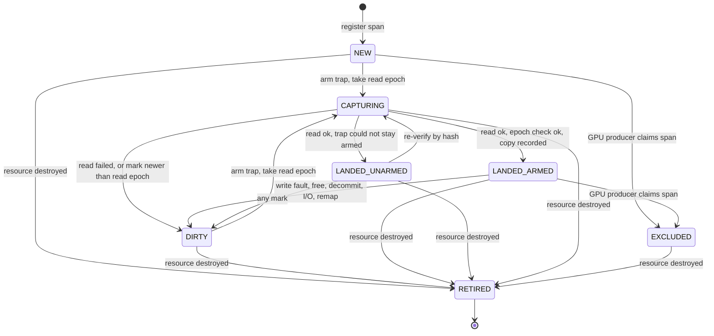

# Exact texture data at submission: a design specification

## 0. Purpose and scope

> **How to read this.** These rules are written as requirements, distilled from our implementation, its design reviews and its failures. Where a rule is stricter than what we shipped, or our code differs in detail, the topic documents ([04-write-detection.md](04-write-detection.md), [05-exact-staging.md](05-exact-staging.md)) describe what we actually built.


This document specifies a mechanism for a PC translator of an Xbox One D3D12.X title. The mechanism is called the exact path. Before every ExecuteCommandLists call, the exact path makes sure that every texture the submission can sample holds the same bytes on the PC GPU that it would hold on the console. We call this "console equivalence at submission".

The document is written so that an outside engineer can build the same thing for an Xbox Series X translator. It states definitions, a correctness contract, numbered rules, a cost model with measured numbers, two worked root-cause case studies, and a test plan.

A note on evidence. The rules in sections 3 to 9 are the contract. They come from the working implementation and from two design reviews, and they are written as requirements, not as a description of one code base. The measurements in section 10 come from real runs on three machine classes: an RTX 3080 laptop, an RTX 4090 desktop, and an AMD handheld running under SteamOS and Proton. Where a number is an estimate, the text says so. Where a claim is not proven, the text says "unverified".

Scope limits. The document covers CPU-authored texture data (streaming, decompression, title writes into mapped memory). GPU-authored data stays on its native GPU path (section 9, rule 41). The document does not promise bit-identical final pixels across GPU vendors. The contract is data and version fidelity: the right bytes, in the right version, in the native image, before the consumer runs.

## 1. Why an exact path exists

On the console the CPU and GPU share one memory. The title writes tiled texture bytes into that memory and later submits GPU work that samples them. No upload step exists. The GPU reads whatever is in memory when the work executes.

A discrete PC GPU cannot do that. The translator must copy the bytes into a native image. The title does not tell the translator when it finished writing, because on the console it never needed to. Three approaches exist:

1. Copy on a timer or on a guess ("probably ready"). This shows black or stale textures when the guess is wrong.
2. Copy at resource creation only. This misses every later write.
3. Detect writes, copy changed data, and refuse to submit a consumer until its data is current. This is the exact path.

The exact path costs CPU time on the submitting thread. Most of this document is about keeping that cost bounded without weakening the contract.

## 2. Definitions

**Resource.** A title-visible texture object with a format, dimensions, mip count, array size, and a placement in title memory.

**Generation.** One lifetime of the allocation identity behind a resource. A new allocation, an address reuse after free, or a descriptor re-binding to different memory starts a new generation. All state is keyed by resource and generation. Descriptor identity and content identity are separate things.

**Span.** A contiguous range of title memory, widened to whole pages, that holds the raw tiled bytes of one subresource (one mip, slice, or plane) of one generation. A span is the unit of capture, hashing, trapping, and landing. Packed mip tails and tile padding can make two subresources share pages. Shared pages make the spans overlap, and the overlap rules in section 5 apply.

**Source.** The title memory a span reads. The translator does not own it. The title can free, decommit, remap, or rewrite it at any time.

**Mark.** An event that says "the source bytes of this range may have changed". Each mark carries a source kind and a global sequence number. Source kinds are: write fault (from a trap), I/O completion, free, decommit, commit, protection change by the title, registration of a new resource, and a read-complete notice from the title's own streaming layer. A mark never says the bytes did change. It says the translator can no longer prove they did not.

**Token.** The per-span trap object. A token holds the span's page range, its protection state (armed or disarmed), the recorded original protection, its trust state, and its sequence numbers (mark, capture, landed, map). Section 4 gives its state machine.

**Capture.** Copying the span's source bytes into a private snapshot that the title cannot touch, then hashing and detiling it. A capture is bound to one capture sequence number.

**Landed.** A span is landed when a GPU copy of one specific capture has been recorded into a command list that executes before the consumer on the same queue (or is ordered by a cross-queue signal and wait). A landed record stores the capture sequence number and the hash of the bytes it copied.

**Trusted.** A span is trusted when the translator can prove that its landed version equals the current source bytes. Section 6 gives the predicate.

**Reach.** A submission reaches a span when any command list in it can sample that span. Reach is computed from descriptors, bundles, and draw records at record time and at execute time. Bindless tables make the exact set unknowable, so reach is a conservative superset: spans that are new or dirty, intersected with spans reachable through live descriptor heaps.

**Epoch.** A monotonic counter used to order captures against faults. Every mark takes the next global epoch value. Every capture takes a read epoch after it arms its trap and before it reads. Section 7 uses epochs to decide whether a capture is current.

**Lease.** A shared hold on a stripe of title address space during a capture. A title free or decommit that overlaps a leased stripe waits for the lease to end. Section 8 gives the rules.

**Signature.** A small record of what a mapping looked like when the lease was taken: allocation base, allocation incarnation number, page state, and protection. Section 8 uses it to detect address reuse.

**Barrier.** The code that runs inside the translator's ExecuteCommandLists hook, on the submitting thread, before the real submit. It enumerates reach, makes every reached span trusted or fails the submission's exactness, and then lets the real submit proceed.

**Head-start worker.** A helper thread that captures spans early, after a mark but before the next submission, so the barrier finds finished work. Head-start work is speculative: it may be wasted, and it may race with the title.

**Breach.** A violation of the contract that the translator detects and logs. Section 9 classifies breaches.

## 3. The correctness contract

### 3.1 Statement

C1. For every ExecuteCommandLists call, for every span in its reach set, the GPU bytes of that span at execution time equal the source bytes as they stood at the moment the barrier finished, for every write that completed before the barrier began.

C2. The barrier may take any amount of CPU time. It may not wait on a GPU fence, drop a submission, substitute a placeholder, use a lower mip, or reuse an older generation's image.

C3. If the barrier cannot make a reached span trusted (unknown layout, unreadable required bytes, a source that vanished), the submission's exactness is broken. The translator reports a breach. It does not hide the span behind zeros.

### 3.2 The allowed lateness

On the console, a CPU write that races with a GPU read has no defined result. The title must synchronize if it needs a defined result. The translator therefore needs to preserve only synchronized accesses.

The contract allows one submission of lateness for one case: a write that is still in progress while the barrier runs. Such a write may appear on the GPU in this submission or in the next one. A write that completed before the barrier started may not appear late.

This allowance is narrow. It does not permit:

- a completed write that waits for a timer;
- a write that stays invisible for two submissions;
- a stale span that nothing ever repairs.

Rule 14 turns this into a mechanism: a fault during capture makes the capture untrusted, and the span stays untrusted until a later capture succeeds.

### 3.3 Non-goals

Torn reads from unsynchronized writers have no console-defined value, and equal input bytes do not give equal pixels across GPU vendors. The contract covers synchronized accesses and data fidelity only.

## 4. The token state machine

Each span has one token. The token has these states:

- **NEW**: the span was registered, never captured. Untrusted.
- **DIRTY**: a mark arrived after the last landed capture. Untrusted.
- **CAPTURING**: a capture is in progress. The trap is armed. Untrusted.
- **LANDED_ARMED**: a capture finished, its copy is recorded, and the trap is armed and intact. Trusted if the section 6 predicate holds.
- **LANDED_UNARMED**: a capture finished but the trap could not stay armed (arm refused, shared page, or partial-page span). Untrusted for skipping purposes: the barrier must re-verify by hash (rule 24).
- **EXCLUDED**: a GPU producer owns the span. The CPU path does not touch it (rule 41).
- **RETIRED**: the generation is over. Terminal.



Transitions out of CAPTURING that end in DIRTY are normal. They are not breaches by themselves. A breach arises only when a reach finds the span in a state other than LANDED_ARMED (or a verified LANDED_UNARMED) with no pending repair (section 9).

### 4.1 Numbered rules for the token

1. A span is keyed by (resource, generation, subresource). A new generation creates new tokens. It never inherits a landed copy.
2. Every token starts in NEW. A new allocation always starts dirty.
3. Only the transitions in the diagram are legal. Any other transition is a bug and must be logged as an internal fault.
4. Every mark moves a LANDED token to DIRTY and stores the mark's epoch in the token. A mark on a token in CAPTURING does not change its state. It raises the token's mark epoch, and the capture check in rule 15 then fails.
5. A mark applies to every token whose page range overlaps the marked range, including tokens that share a page with the marked span (packed tails, tile groups). Over-marking costs work. Under-marking breaks exactness, so overlap tests are conservative.
6. RETIRED is terminal. The retire rule (rule 31) says when it happens.

## 5. Arm, disarm, and exclusion rules

The trap is page protection. Arming makes the source pages read-only so that a title write faults. The fault handler records a mark and lets the write proceed.

7. **Arm before read.** A capture arms the trap first, then takes its read epoch, then copies. A write during the copy faults and raises the mark epoch above the read epoch. This ordering is the foundation of rule 15.
8. **Preserve flags.** Arming changes the protection to read-only and keeps every other protection flag, including write-combine. Disarming restores the recorded original protection. The token records the original protection at arm time.
9. **Verify before restore.** Before restoring protection, check that the allocation base and current protection still match what the token recorded. If the title changed the mapping meanwhile, do not overwrite the title's protection. Mark the span dirty instead.
10. **Arm refusal is untrust.** If the arm call fails or the span cannot be armed (shared page that another token holds in a conflicting state, partial-page span, an allocation the title protects itself), the token cannot be LANDED_ARMED. It moves to LANDED_UNARMED at best. A LANDED_UNARMED span is trusted only for the duration of one barrier, and only after a fresh hash compare (rule 24).
11. **Partial-page spans.** If a span does not cover whole pages, the unrelated bytes on its pages also fault when written. The fault marks the span even if the title wrote outside it. That is a false positive and is acceptable. A false negative is never acceptable.
12. **Guard pages are not traps.** Do not use one-shot guard-page protection as a persistent dirty bit. It fires once, and system services can trip it.
13. **Exclusions.** The CPU path must not arm or capture:
    - a span whose resource a GPU producer owns (rule 41);
    - a span in a dying or retired generation;
    - a span whose pages the translator cannot prove readable at capture time (the capture then fails, and rule 29 applies).
14. **Fault handler rules.** The handler records the mark and returns `EXCEPTION_CONTINUE_EXECUTION` so the store retries. It does not log, allocate, use static TLS, take the barrier lock, or wait. It restores the original protection of a page only when the last armed token on that page is released (its armed count drops to zero), using the rule 9 identity check. Logging and cleanup happen later, in the single drain consumer.

Costs of the trap, measured: a typical present arms about 67 times and disarms about 67 times, the trap handler runs less than one time per present, and the protect calls cost about 0.18 ms per present on the calling thread. These are small. The real cost of traps is indirect: the process-wide virtual-memory lock that protect, allocate, and free calls share (section 10.5).

Trap mode is not the only mode. A scan mode that hashes source bytes at each reach, with no traps, also exists. It is slower but needs no protection changes. The contract holds in both modes, and the snapshot-read faults in section 12 occurred in scan mode as well. So traps are not the cause of those faults.

## 6. The trust predicate

15. **Capture ordering by epochs.**
    A capture is current if and only if, after the copy, the token's latest mark epoch is less than the capture's read epoch. Compare against the token's own spans and every overlapping span's marks. If any mark is newer, the capture is stale. Discard it and leave the token DIRTY. The copy may still be useful as a hint, but never as landed data.

16. **Trust predicate.** A span is trusted at a barrier if and only if all of these hold:
    - a. The token is LANDED_ARMED, or LANDED_UNARMED with a hash compare done inside this barrier.
    - b. The landed copy's capture epoch is greater than the token's latest mark epoch.
    - c. The landed copy's generation equals the span's current generation.
    - d. The landed copy's layout tuple equals the span's current layout tuple (format, dimensions, tile mode, pitch, plane, slice base, depth, tail placement).
    - e. The GPU copy that implements the landing is ordered before the consumer on the consumer's queue (same-queue order, or a signal and wait).
    - f. No GPU producer has written the span since the landing (rule 41).

17. **Failure to capture.** If a capture fails (source read fault, commit failure, unknown layout), the token goes to DIRTY with a failure record. The span stays untrusted until a later capture succeeds or the generation retires.

18. **Zero is never a fallback.** Unreadable required bytes do not authorize zeros. A hash of zeros is a valid hash of a zeroed allocation. Zero-pages-as-trusted is allowed only when the source is provably a fresh committed allocation that the title has not written.

19. **Hash role.** The hash is an equality filter. Equal hashes mean "unchanged" only inside the same generation and layout tuple. Use a cryptographic hash (we use SHA-256, bit-identical to the system provider and self-tested at startup). A weaker or faster non-cryptographic hash is acceptable only with a byte compare before an equal-accept.

## 7. Capture, head-start, and the epoch protocol

20. **Immutable snapshots.** A capture writes into a private buffer. The buffer is never reused while a landed job can still read it. A reused snapshot buffer must be zero-filled where an operating system would have returned zeros, or the consumer must only read the bytes this job wrote.

21. **Guarded read.** The source read runs inside a structured-exception guard. A fault on the source is a normal outcome. It produces a failure record with the exception code, address, and instruction pointer, captured after unwinding. The guard does not log, allocate, or take locks.

22. **Commit before read.** The capture commits the private buffer first, as a separate step. A commit failure is its own breach class (class B in section 9). Do not fold commit and read into one guarded step, or the failure counters cannot tell them apart.

23. **Head-start is speculative.** The head-start worker may capture a span after a mark. It must follow rules 7 and 15 exactly. Its result is a candidate, not a landing. The barrier takes the candidate only if rule 15 still passes at take time.

24. **Barrier re-verification.** For each reached span that is not trusted, the barrier either takes a finished head-start job (after the rule 15 check), or stages the capture inline on the submitting thread. For LANDED_UNARMED spans it rehashes the source and compares it with the landed hash before trusting.

25. **Jobs are keyed, not queued blind.** A job refused at submit time (generation changed, GPU owner appeared, negative state) must not be re-prepared in a loop. Check the refusal predicate before preparing. If the predicate is certain to refuse, park the span until a state change (a new generation, a transition, a landing event) wakes it. Section 11.4 shows what happens without this rule.

26. **Late retry for faulted spans.** A span that failed capture must be retried at its next reach, not only on the head-start schedule. Rule 36 requires the retry to be visible in logs.

Epoch order in time, for one capture:

```
arm trap  ->  read_epoch = next()  ->  copy source  ->  hash + detile
          ->  check: all overlapping marks < read_epoch ?
                 yes -> record landing (GPU copy ordered before consumer)
                 no  -> discard, token stays DIRTY
```

## 8. Leases, signatures, and mapping lifetime

The translator does not own title memory. The title can free it while a capture reads it. `VirtualQuery`-style queries describe a page at one instant. They do not pin it. A "readable" check before a copy proves nothing about the copy.

27. **Lease.** A capture takes a shared lease on every address stripe its source range touches. A title free, decommit, or remap hook takes the stripe exclusively before it calls the operating system. The hook waits for in-flight captures that overlap. Stripes keep contention low: a hook waits only for captures that share its stripe.

28. **Signature rule.** At lease acquire, record the signature of the source mapping: allocation base, incarnation number, page states, protection. After the copy and before landing, re-read the signature. If any field differs, the capture is stale. Address reuse (free and re-reserve at the same address) changes the incarnation number, so the old generation cannot pass as the owner of the new bytes. Current-coverage tests such as "does the title still reserve this range" do not satisfy this rule, because release and re-reserve can satisfy coverage for the wrong owner.

29. **Lock order.** Fix one global lock order and write it down. Ours, in the fault handler: trap registry (shared), then one span lock, then lock-free list publication, and nothing else. Lease stripes are always taken in ascending stripe order. The barrier thread must not hold a lease while it waits for a head-start job that itself needs a lease.

30. **Free and decommit marks.** A title free or decommit does two things in order: it records a "pre" mark before the operating-system call, and a "done" mark after the call succeeds. A pre mark is not a completed event. Only a done mark proves that the mapping changed. The latest successful destructive event for a range is stored separately from the latest arbitrary mark. A later read-complete mark must not overwrite it.

## 9. Retire, breach classes, and what the barrier must and must not do

### 9.1 Retire rule

31. A generation retires when its resource is destroyed, after the translator removes its state and disarms its traps. Retirement is an object-lifetime event. It does not prove that the source memory is gone. A span of a retired generation is never a reach target, so it needs no further trust.

32. A job pin keeps a resource object alive. It does not keep the source allocation alive. Do not treat a pin as protection for source memory.

33. Retirement does not cancel an obligation for a still-live submission. If a submission already recorded a reach on a span, the span's data must be correct for that submission, even when the resource retires right after.

### 9.2 Breach classes

A breach is logged when the contract breaks in a detectable way. Each class has a different meaning and a different response:

- **Class A, source read failure.** A guarded read on the source faulted. The attempt produced no data. Meaning: the source vanished or was unmapped during the capture. Not by itself a stale reach. The span stays DIRTY (rule 17). It becomes a class C breach only if a later reach finds the span still untrusted.
- **Class B, commit failure.** The private snapshot buffer could not be committed. Meaning: resource exhaustion on our side. Always a real defect to fix (or a capacity limit to raise).
- **Class C, stale reach.** A submission reached a span that was not trusted and had no repair in front of the consumer. This is the true exactness failure. Meaning: the GPU may sample old or missing bytes.
- **Class D, unsupported layout.** The span's layout is not in the validated set. Meaning: the exact path cannot make this span trusted. The consumer must not run in exact mode (rule 40).
- **Class E, evidence loss.** A diagnostic ring or event queue overflowed, or a receipt is missing. Meaning: the run's audit is incomplete. A gate treats this as a failure, not a pass by silence.
- **Class F, mismatch in a shadow mode.** A second implementation (a different hash, a CPU oracle, a read-back digest) disagrees with the fast path. Meaning: one of them is wrong. Treat as a defect until proven otherwise.

34. Every breach is logged with: attempt id, caller kind (head-start, barrier on direct queue, barrier on secondary queue), thread, resource, generation, span, capture and mark epochs, and the result of the source query at that moment.
35. A breach never silently clears. A cleared state needs a recorded repair or a recorded retirement.
36. A failed span stays "unresolved" until repaired or retired. Targeted reach rows continue until then. A first-reach-only trace with a global row cap is not acceptable, because the cap hides later reaches (section 12 shows this failure).
37. Counters for breaches are monotonic and never reset mid-run. A gate checks that attempts equal commit failures plus explained cancellations plus unexplained reads plus other exception failures.

### 9.3 What the barrier must do

38. Enumerate the reach set for this submission (new or dirty spans intersected with reachable heaps, plus ordered GPU producers).
39. Make every reached span trusted by rule 16, using finished head-start work first and inline capture second.
40. If a span cannot be made trusted (for example its source is unreadable), do not invent data and do not drop the title's work: log a breach with full context, let the title's submission go exactly as the title made it, and mark the run as not exact. A run with breaches is invalid as evidence; the title still runs. Never present such a submission as exact.
41. For GPU-produced textures, leave the native GPU producer authoritative. Preserve its barriers. Reconcile aliases at the real producer-to-consumer transition. Across queues, use producer signal then consumer wait with correct state transitions. Never put a CPU upload in front of a GPU-written span.
42. Make all landing copies part of the same submission stream, ahead of the consumer on the same queue, so the GPU orders them. No CPU wait on the GPU is needed for ordering.

### 9.4 What the barrier must not do

43. **No fence waits.** The barrier does not wait on a GPU fence to learn that a copy is done. Same-queue order gives that for free. A fence wait turns GPU latency into CPU stalls and can deadlock when the producer needs the blocked thread.
44. **No dropped submissions.** The barrier never discards an ExecuteCommandLists call to avoid work. It may take longer. It may not skip.
45. **No placeholders.** Black, a lower mip, an older generation's image, or "the previous lap's texture" are not exact. A placeholder is a breach, not a fallback.
46. **No speculation about readiness.** Do not use a timer ("probably done after 50 ms"), a worker cadence, or a hash-only readiness check to decide that a span is current.
47. **Do not split a call.** Do not break one ExecuteCommandLists call into several real calls to submit a ready prefix early. D3D12 decays certain buffers and simultaneous-access textures to the common state at the end of every call. Splitting adds decay points, and later lists can see different implicit states. A needs-only differential test would not catch that. This idea needs its own design review before any attempt.
48. **No budget-driven staleness.** A time or byte budget may limit advance (head-start) work. It must never authorize submitting a stale consumer. When the budget runs out, the consumer waits for exact data.

### 9.5 Bounded blocking

49. The barrier's inline work is bounded by the bytes it must capture, not by a timer. The contract accepts long pauses when the data requires them. Report them plainly. Do not relax exactness to hide them.

## 10. The cost model

### 10.1 Cost terms

For one present, let:

- R be the raw tiled MiB captured;
- L be the output footprint MiB after detile;
- N be the number of textures touched;
- H be fixed overhead (allocation, locks, dispatch, hooks).

CPU route (measured coefficients from a mixed population on one machine): about 0.27 ms per MiB for the snapshot and about 2.2 ms per MiB for the CPU detile converter, plus H. These are proxies. They are not predictions and not upper bounds.

GPU detile route: `capture(R) + raw transfer(R) + detile(R,L) + buffer-to-image(L) + H`. Count the host transfer once.

At those coefficients, a 16 MiB burst costs about 40 ms on the CPU route, and a 64 MiB burst costs about 160 ms. A GPU detile route under assumed bandwidths (12 GiB/s host to device, 200 GiB/s device) would cost about 6 ms and 24 ms plus H. The bandwidths are an illustrative scenario, not a measurement. Block compressed formats (BC4, BC6H and similar) move block bytes unchanged. Never decompress and recompress them, never approximate float blocks, and never treat compressed images as writable unordered-access textures.

### 10.2 Where time goes per present (laptop, RTX 3080 mobile, 8 cores)

Matched lap phases, fix off versus fix on, mean ms per frame on the title's present thread:

| Phase | Total off | Total on | Delta | Of which outside any wrapper scope | Of which submit |
|---|---:|---:|---:|---:|---:|
| Late lap | 21.74 | 28.56 | +6.82 | +5.32 | +2.72 |
| Early lap | 23.44 | 42.08 | +18.64 | +11.66 | +6.34 |

Texture preparation on the title thread fell by 1.1 to 1.8 ms, because the exact path moves it into the barrier and into helpers. The columns for lock wait and other waits rose by 0.3 to 0.9 ms.

The barrier stall (time inside the hook before the real submit) is heavy-tailed. In settled frames its median is 0.8 ms and its mean is 6.2 ms. About a quarter of presents stall more than 5 ms. The worst 10 percent carry 63 percent of all stall. Each 1 ms of stall adds 1.15 to 1.22 ms to the frame (correlation 0.89 to 0.93). That is a little more than the stall itself, because the submitting thread also delays its own title work.

Inside the barrier, per present: staging 3.35 ms, waiting for staging 0.77 ms, submit 0.26 ms, harvest 0.21 ms, enumerate 0.15 ms, classify 0.05 ms. Across all threads the hash cost is about 1.17 ms per present and prepare cost about 1.41 ms. A profile of the barrier's exclusive time put source reads into the snapshot at 32 to 48 percent, waiting for a head-start job at 9 to 18 percent, CPU detile at 13 percent, hash at 5 to 7 percent.

Per present on average: about 12.7 spans needed exact data, about 1.15 MB was copied, about 134 protect calls and 27 allocate or free calls ran, and the trap handler ran 0.77 times.

### 10.3 The cost the title thread does not see in wrapper timers

Most of the delta is "outside" time. The exact path adds hooks that run on title threads with no timing scope:

| Hook | Rate per present | Measured CPU on submit thread | Measured CPU on all threads |
|---|---:|---:|---:|
| Bundle reach recording | about 1,456 bundle calls | 2.07 ms | 15.2 ms |
| Descriptor-copy bookkeeping | about 4,414 writes | 0.7 ms | 1.5 ms |
| Draw reach recording | about 480 draws | 0.08 ms | 0.39 ms |
| Release flips | about 935 releases | 0.03 ms | 0.22 ms |

These came from an older build with timing on, so treat them as indicative. They total about 2.9 ms on the submit thread, against 5.3 ms of unexplained outside growth in the late lap. The rest is inferred, not measured: the submit thread waits on title worker threads that carry hook CPU, virtual-memory lock contention and TLB effects from protect, allocate, and free calls, and title GPU waits after delayed submissions.

### 10.4 The same path on the AMD handheld

On the handheld under Proton, matched race frames cost +1.56 ms with the exact path on (27.01 ms versus 25.45 ms). The GPU is not the limit: GPU busy time per frame is 22.6 ms with the exact path and 22.5 ms without. Command buffer counts match (50 versus 51). The cost is CPU latency in front of the main render lists. In traced frames the title's first large list reached the GPU 9 to 26 ms late, with the GPU idle meanwhile. Tracing inflates absolute times. The comparison is like for like.

The largest single item is SHA-256 in a portable C implementation inside the compatibility layer. It runs at about 115 to 135 MB/s, costs about 8.4 ms CPU per frame in total (head-start 2.76, workers 4.88, present thread 0.74 to 1.14), and makes the present thread wait about 3.1 ms per frame. Hardware SHA instructions give identical digests at about ten times the speed, so this change is exact-safe if it ships with a CPU feature check, a startup known-answer self-test with fallback, and a dual-hash audit mode. The exact path adds about 0.75 to 1 core of CPU, almost all on helper threads. At a fixed 15 W power budget, every CPU cut helps even in GPU-bound stretches.

### 10.5 Wasted helper work

The head-start worker can waste most of its time. In a long idle pre-race screen it prepared about 53,000 textures a minute and sent 34 to the GPU. About 44,400 jobs a minute were prerecorded and then discarded. It snapshotted about 8.5 GB a minute. On the handheld that was 0.7 to 1.1 cores of CPU in menus and up to about 0.4 cores in races, much of it waste. The cause is a refused job that goes back through the queue and is prepared again (rule 25). The refusal reasons were not logged, so the exact split is unverified. A counter build that records the refusal reason per job decides the fix. A related effect: 400 to 1,200 textures sat stuck with only their smallest mip tail for minutes. If such spans are cube, array or volume textures with no barrier path, nothing lands them. That would produce black textures, and it is unproven.

## 11. Worked case study 1: why the exact path cost what it cost

### 11.1 Symptom

On the laptop, a session with the exact path on had a settled median frame time of 27.6 ms against 21.2 ms with it off, a gap of 5 to 6 ms. The reviewers first suspected a flat per-frame cost from the exact path.

### 11.2 Analysis steps

1. **Check that the two arms hold the same frames.** They did not. Video capture covered the first 10,000 presents only. The off arm reached lap two at about present 11,240, so its settled set held lap one only. The on arm reached lap two at about 8,870, so its set included lap two. The settled windows were fixed wall-time windows, so slow early-lap segments contributed fewer frames.
2. **Compare matched lap phases.** In the early lap the gap was 18.6 ms per frame. In the late lap it was 6.8 ms. There was no flat cost. The pooled median sat between two clusters.
3. **Split the present thread's time by wrapper scope.** Only 22 percent (late) and 37 percent (early) of the delta was wrapper-timed work. The rest was time outside every scope.
4. **Read the code for what runs outside scopes.** With the exact path on, hooks on bundle execution, descriptor copy, draw, and release all ran on title threads with no timing. A lock census put them at about 2.9 ms on the submit thread and about 17 ms of CPU across all title threads per present.
5. **Look at the stall distribution.** The stall was heavy-tailed. A linear fit of frame time on stall gave a slope of 1.15 to 1.22 and an intercept of about 25.8 ms, which is 3.5 ms above the off mean. So about 7.6 ms of the settled gap was tied to the stall and about 3.5 ms was constant overhead.
6. **Check three build variants.** The newest build looked 1.5 ms slower, but its settled set held more early-lap frames. At a common 45 percent early share, the three builds' medians were 26.7, 26.7 and 26.2 ms. Candidate causes (hash chunking, new counters) measured at 0.05 to 0.09 ms per present or nothing measurable, so they were rejected.
### 11.3 Root cause

The cost had three parts, not one:

- A heavy-tailed barrier stall. The barrier staged most of its roughly 12.7 needs per present inline, because the head-start worker did useful work in only about one pass in twelve. Of 44.7 requests per present, only 1.1 jobs were used. Others were dropped as already done, dropped as busy, or had no job.
- Unscoped hook CPU on title threads. Bundle reach recording alone was about 10 microseconds per bundle across about 1,456 bundles per present.
- A measurement artifact: unequal frame sets in the two arms, which inflated the apparent flat gap.

### 11.4 Lessons

- Measure matched phases, not pooled medians. Put timing scopes on every hook that runs on a title thread. Judge a head-start worker by its useful-pass ratio. A long-run average of bytes copied says nothing about a burst, and bursts cause hitches. The most promising fix: stage dirty spans on the head-start worker at mark time, not at request time (estimated 1.5 to 3 ms late, 4 to 8 ms early, unmeasured).

## 12. Worked case study 2: why snapshot reads faulted

### 12.1 Symptom

Three long runs logged 590, 1,645 and 267 breaches of the "snapshot read" kind. One run had no trap at all (scan mode), yet it had the most. Earlier analysis assumed the breaches were harmless end-of-life events. That was not proven.

### 12.2 Analysis steps

1. **Pair each breach with its cause.** An early test looked at the four log lines after a breach for a source fault. That test fails because another thread's output interleaves, and it can attach the next attempt's fault to the wrong breach. A same-thread pairing worked: every one of the 2,502 breaches had exactly one preceding access violation on the same thread, a read, inside the memory-copy routine. The two loader caller addresses were the same for every pair within a build. No commit failure was observed in any run.
2. **Split by thread.** 2,492 faults came from head-start worker threads. 10 came from title or barrier threads. None came from other threads. So the failure was overwhelmingly in speculative work.
3. **Check the traps.** The scan-mode run, with no traps, had 1,645 failures. Traps are not necessary for this symptom. The arm operation sets read-only and keeps reads legal, so a read-only transition alone cannot explain a read fault.
4. **Look at the code path.** The stage function checked readability, armed the trap, assigned the read epoch, reserved memory, and then did commit and guarded read in one step. A successful readability query cannot stop a later free or decommit. The readable check also does not show that the allocation still belongs to this texture. The stage function held no lease on the source mapping, so a title free could race the copy. The title's real free ran under a boundary lock, but the head-start stage did not.
5. **Check the mark ordering.** A "pre" mark before a free can queue head-start work while the memory is still readable. The actual free then races the copy. A latest-mark record cannot rebuild what happened, because it keeps only the latest source kind and sequence, and a later read-complete mark overwrites it.
6. **Check whether the breaches were harmless.** For 19 traced generations in the long run, 27 breaches followed the first reach. The trace printed first reach and first after-reach rows once only, and stopped printing untrusted rows after 64 globally. So there were no later rows for any of the 27, and that absence proves nothing. 11 of the generations retired later. 8 had no retirement in the log. One generation had eight failed captures spread over about 4,900 presents and never retired, so it could not be called "retiring". Same-span copies after a failure happened in 38 cases across the three runs, so "never copied again" was false.
7. **Check the existing classifier.** A helper that treated "not readable now, or mark sequence at least the draw sequence" as proof of a raced read accepted any mark source, so a read-complete mark or a write-watch mark could make a real stale span look harmless. It was rejected as a harmlessness test.

### 12.3 Root cause

The immediate cause is a source-read fault in speculative head-start capture. The title freed or decommitted the source between the readable check and the copy, and the capture had no lease and no signature check. The attribution of each individual historical fault to that interleaving is unverified, because the logs hold no per-address completed-free timeline. The 10 title-thread faults need their own receipts.

A real stale reach is not demonstrated. A harmless classification for every row is also not demonstrated. The correct response is to log enough to decide, and to keep the exactness gate open.

### 12.4 What the design now requires

- Rules 21 and 22: split commit and read, capture the exception record after unwinding, and give each failed attempt an id and a caller kind.
- Rules 27 and 28: lease the source stripes and check the mapping signature before landing.
- Rule 30: keep the latest successful destructive event separate from the latest mark.
- Rules 35 and 36: retain a failed span as unresolved, and log every later reach of it, without a global cap.
- A conditional cancellation class (not yet accepted). A source-read fault may be counted as "cancelled by lifetime" only when all of these hold: the commit succeeded; the fault is a read inside the requested source range; either the same generation retired before classification, or a completed free or decommit receipt overlaps the faulting range and has a sequence number later than the capture; and nothing recommitted or remapped the range before classification. A pre mark, a dying flag, a generic mark sequence, current unreadability, arena coverage alone, or an eventual retirement is not enough. Cancellation applies to that one attempt, not to the texture's future obligation. Do not advance landed, hash, or trust. If a surviving resource's source is recommitted, its next reach must verify it.
- A free that predates the capture does not cancel anything. The worker may have copied foreign or reused pages. Keep such a case a breach until an ownership rule is written.
- Do not hold a whole-stage lock in the worker to fix this. The barrier waits for the worker, so a naive lock can deadlock. Any lock change needs its own order proof (rule 29).

## 13. How to test it

### 13.1 Self-tests

Run known-answer tests for every hash and detile implementation (standard vectors, random lengths 0 to 64 KiB, unaligned addresses), state-machine tests for every legal and illegal transition, lock-order tests under a deadlock detector, and a protect cycle test (arm, change protection from another thread, confirm rule 9 refuses to overwrite it). A failed known-answer test falls back to the reference.

### 13.2 CPU oracle (the reference)

Build a blocking, single-threaded reference path that is allowed to be slow. For a layout the vendor converter supports completely, it captures, converts, and compares every defined payload byte. Hashes alone are not proof. Test:

- complete mip chains with random payloads;
- edge and non-power-of-two sizes;
- every tile mode the inventory has seen;
- block-compressed formats, including all mip and tail placements;
- arrays and cubes (every layer and face, including cube arrays);
- true 3D addressing with depth that shrinks per mip, not stacked 2D detile;
- planar, depth, and multisample classes, once their addressing is supported.

For a layout that no converter supports, the oracle must say "unsupported" and the translator must raise a class D breach.

An address map is a useful bootstrap for permutation-only layouts. Pass synthetic tagged bytes through the vendor's converter, derive source offsets for each output block, verify with independent random patterns, and cache the map by the full layout tuple. If the map is not a bijection, it is not a permutation and needs the CPU oracle. A map costs storage: one 32-bit offset per BC4 block adds 50 percent of payload.

### 13.3 Negative controls

Every suite needs controls that must fail: wrong swizzle, a skipped layer or tail, a stale epoch accepted, a missed write, a dropped cross-queue dependency, a placeholder substituted for a span, and a free that races a copy.

### 13.4 Failing-first fixtures for the capture and lifetime rules

Each fixture must show the old, unsafe behavior fail the specific assertion before the candidate change passes. Run each in scan mode and trap mode.

1. **Decommit between capture and copy.** Pause after the precheck. Decommit the source. Resume. The result must be a source fault with an exact range, and no landed state and no trust advance.
2. **Failed destructive call.** A pre mark followed by a failed free, then a separate injected source fault. The case must remain an unexplained breach. A pre mark never qualifies for cancellation.
3. **Commit failure.** Inject a private commit failure with a readable source. The result must be a class B breach, no guarded read called, no cancellation.
4. **Non-lifetime mark.** A read-complete or write-watch mark after capture plus an injected source fault. It must remain a breach even when the latest mark is newer than the capture.
5. **Address reuse.** Release and re-reserve the same address before classification, while the old generation survives. The new incarnation must fail the signature rule. Current coverage must not validate the old owner.
6. **Live later reach.** Fail a read, recommit the source with changed bytes, and submit a reach before repair. The fixture must detect old GPU bytes. The targeted reach row must persist until repair.
7. **Retire race.** Retire the same generation while a capture runs. A control retires a different generation. Only the same-generation case may qualify for cancellation.
8. **Partial span and destination fault.** A decommit outside the failing span, and an injected write fault on the destination buffer. Neither may qualify as a source-lifetime cancellation.
9. **Trace saturation.** Emit more than 64 unrelated untrusted rows, then fail and reach a traced span. The old trace must lose evidence. The new attempt-linked rows must stay complete until repair or retire.
10. **Ownership between worker and barrier.** A deterministic interleave of worker wait, barrier take, mapping change, and concurrent retire. No new lock cycle, no stale trust publication, exactly one result, correct caller kind.
11. **Event loss.** Overflow the event ring, and overwrite the latest source with a read-complete mark after a free. Lost coverage must block the gate. The separate successful receipt must survive, or the case stays a breach.

Also add race fixtures for: query, reset and copy overlap; shared pages; alternate aliases; descriptor overwrite; decommit and recommit; asynchronous I/O completion; GPU-to-CPU ownership change; multiple queues. Fuzz the schedules.

### 13.5 Differential and shadow modes

- **Dual hash.** Run the fast and the reference hash on every capture. A mismatch is a class F breach.
- **Reach differential.** Run two reach-recording implementations side by side and compare (list, needs, landed sequence) at each submit.
- **Fresh versus pooled snapshots.** Compare bytes per job. A difference means rule 20 is broken.
- **OFF versus OFF.** Run any new gate three times with the feature off. A gate that fails with the feature off is flaky and cannot judge the feature.
- **Controls.** Compare each change against a same-vendor control and another vendor's GPU.

### 13.6 Audit mode

An audit mode runs on top of the normal path and adds checks:

- **Read-back digest.** After a landing, read back the GPU bytes of selected spans, in an ordered, stable way, and compare the digest with the source digest taken at capture. Scope it to failed spans and selected names, and measure its perturbation. A fresh readable check followed by an unprotected hash has the same race as the path under test.
- **Source change without a mark.** For every capture, compare the source bytes later with the landed bytes. A change with no mark in between is a missed write. This count must be zero over a complete run.
- **Skip audit.** When a switch skips re-copies of landed spans, the audit must show zero rejected skips and zero changes without marks, over a complete run, before the switch becomes default.
- **Receipts.** Keep per-address free, decommit, commit, and protection receipts (range, sequence, result, error code, incarnation before and after). Diagnostic rings must never log from the fault handler, and an overflow fails the gate.
- **Targeted reach rows.** Keep emitting reach rows for unresolved spans until repaired or retired.

Audit modes cost time. Report their overhead separately and never compare an audit run's frame times with a normal run's.

### 13.7 Gate for acceptance

A change to the exact path passes when all hold:

1. All fixtures pass in scan and trap modes, including negative controls.
2. A repeat of the long routes shows: every failure accounted for (rule 37), zero unexplained failures, zero dropped receipts or trace rows, zero stale owned reaches, zero failed live repairs.
3. Existing cache and trap gates are unchanged. Non-zero foreign-copy measurements are not explained away by reclassifying snapshot reads.
4. Perturbation of the audit is measured. Same-vendor and cross-vendor regressions are clean.
5. No claim of "harmless for all rows" or "default on" without the cancellation predicate and later-reach evidence passing.

## 14. Open questions an implementer should expect

- Which refusal reasons dominate wasted head-start work (rule 25). A refusal histogram answers this.
- Whether stuck cube, array, and volume spans have any landing path. If not, they are a correctness defect.
- Whether the compatibility layer honors write-combine flags, which changes the snapshot cost of title memory.
- Menus and pre-race scenes can run uncapped and spin two threads at nearly a full core each. A cap of 30 saved about 1.5 cores in menu rows. This is a pacing setting, not an exactness issue, but it matters at 15 W.

## 15. Suggested build order

1. Inventory every layout and format. Build the blocking CPU oracle and the measurements (per-submission dirty bytes, stage times, percentiles).
2. Add epochs, tokens, leases, and the barrier. Pass the fixtures in section 13.4.
3. Optimize against the oracle: batched GPU detile for block formats, early preparation at publication boundaries, snapshot pooling, faster hashing.
4. Add cross-queue and GPU-written alias handling. Signal then wait, never a CPU fence wait.

A failed gate leaves the work explicitly partial.

---
[Back to the index](../README.md)
